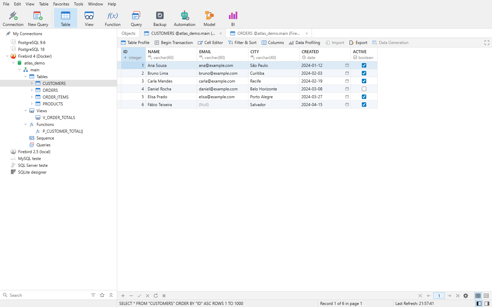

# Atlas DB Manager

[English](README.en.md) · **Português**

Gerenciador de bancos de dados para desktop, nativo e multiplataforma (Windows, Linux e macOS),
feito em **Rust + Tauri 2 + React**. O foco é o trabalho do dia a dia com o banco: navegar pelos
objetos, editar dados num grid rápido, escrever SQL, projetar tabelas e views, mover dados entre
bancos, inclusive de **produtos diferentes**, com a segurança de revisar o que vai ser executado.

> **Status:** versão 0.2.0, pré-alfa. Funciona com **PostgreSQL**, **SQL Server**, **MySQL**,
> **SQLite**, **Firebird** e **Oracle** (em andamento). MariaDB, MongoDB e Redis estão previstos e ficam para depois.



## Bancos suportados

| Banco | Observações |
|---|---|
| **PostgreSQL** | O mais completo: também views materializadas, sequências, tipos, extensões, papéis, tablespaces, servidores e tabelas externas, funções em PL/pgSQL |
| **SQL Server** | Schemas, procedimentos e funções, `IDENTITY` |
| **MySQL** | Bancos como schemas, procedimentos e funções, `AUTO_INCREMENT`. Nas versões antigas o servidor não guarda `CHECK` |
| **SQLite** | Escolher ou criar o arquivo na tela de conexão |
| **Firebird** | Cliente em **Rust puro** (não precisa do `fbclient.dll`); abre `.fdb` e `.gdb`; identidade ou gerador com gatilho, conforme a versão do servidor. |
| **Oracle** | Cliente em **Rust puro** (não precisa do Oracle Instant Client), 12.1 em diante. **Em andamento**: conexão, árvore, grade com edição, editor SQL (inclui blocos PL/SQL), transação manual e designer de tabela com identidade/sequência. Ainda faltam importar, exportar, dump, backup e as ferramentas do menu Tools |

## Funcionalidades

**Conexões**
- Teste de conexão, cores e favoritos, **grupos (pastas)** na árvore, SSL e **túnel SSH** (senha ou
  chave privada, com a chave do servidor guardada no primeiro uso).
- Nova conexão por **URI**, importar/exportar conexões (arquivo sem senhas) e compartilhar uma
  conexão por um endereço `atlas://`.
- Senhas guardadas no **cofre de credenciais do sistema** (Windows Credential Manager, Keychain
  do macOS, Secret Service no Linux) — nunca em arquivo nem enviadas para a interface.
- Configurações locais em SQLite no perfil do usuário, **sem precisar de administrador**.

**Navegação**
- Árvore de conexões → bancos → schemas → tabelas, views, funções e consultas salvas, com
  colunas e ícones próprios para chave primária e chave estrangeira; filtro avançado da árvore.
- Lista de objetos (detalhes, lista e ícones), painel de informações e menus de contexto.

**Dados (grid)**
- Grid virtualizado com cabeçalho de nome + tipo, linhas zebradas e `(Null)` destacado.
- Edição direta com **gravação automática ao mudar de registro**, transação manual (Begin
  Transaction), Aplicar/Descartar e edição de tabelas sem chave primária.
- Valores sempre enviados como **parâmetros** (nada concatenado no SQL) e concorrência otimista:
  o `UPDATE` confere o valor original e falha se outra pessoa alterou o registro.
- Filtro e ordenação em vários campos, escolha de colunas, Cell Editor, lookup de chave
  estrangeira com o rótulo do registro, paginação e limite de registros configurável.
- Menu de contexto da célula: definir NULL/vazio, gerar UUID, copiar, copiar como
  `INSERT`/`UPDATE`/TSV, colar, excluir registro.
- **Data Profiling** (nulos, distintos, únicos, menor e maior valor, valores mais frequentes) e
  **Table Profile** (estrutura, tamanhos e estatísticas).

**SQL**
- Editor SQL (CodeMirror) com destaque do dialeto do banco, autocomplete, executar o trecho
  selecionado, `EXPLAIN`, formatar, cancelar a consulta no servidor, **histórico** de consultas e
  **snippets**.
- **Query Builder** em janela própria: tabelas arrastadas para o canvas, ligações pelas chaves
  estrangeiras, filtros, agrupamento, ordenação e o SQL ao vivo no dialeto do banco.
- **Console** (`F6`) no estilo do terminal de cada banco, com Tab para completar e comandos de
  ajuda.
- **Execute SQL File** de forma atômica, com os lotes `GO` do SQL Server e os blocos `SET TERM`
  do Firebird respeitados.

**Estrutura**
- **Designer de tabela** (campos, índices, chaves estrangeiras, únicos, checks, gatilhos,
  comentário) com prévia do SQL e o **auto incremento** de cada banco: `IDENTITY` no PostgreSQL e
  no SQL Server, `AUTO_INCREMENT` no MySQL, `INTEGER PRIMARY KEY` no SQLite e identidade ou
  gerador com gatilho no Firebird.
- **Designer de view** e **designer de rotinas** (procedimentos, funções e, no Firebird, gatilhos
  pelo texto do `CREATE OR ALTER`).
- Criar, excluir, renomear (onde o banco permite), duplicar e esvaziar objetos, **novo e excluir
  banco**; os comandos de estrutura são sempre revisados antes de executar.
- **Diagrama ER** do schema, **Find in Database** (estrutura e dados, com busca por texto,
  palavra inteira, prefixo ou expressão regular) e **Data Dictionary** (documento PDF com tabelas,
  views e rotinas).

**Importar e exportar**
- Assistente de **exportação** em etapas, para **várias tabelas de uma vez**, em **TXT, CSV,
  JSON, XML, HTML, SQL (`INSERT`), Excel (`.xlsx` e `.xls`) e dBase (`.dbf`)**; do grid já vem com
  o filtro, a ordenação e as colunas visíveis; no editor SQL exporta o **resultado completo** da
  consulta. Gravação em **streaming**, com progresso e **Parar**.
- Assistente de **importação** em 7 etapas, com vários arquivos ou planilhas de uma vez, tabela
  nova com os tipos inferidos e seis modos (acrescentar, atualizar, acrescentar ou atualizar,
  acrescentar sem atualizar, excluir, copiar), continuar em erro por linha e perfis salvos.

**Backup e restauração**
- **Dump SQL** (estrutura e/ou dados), **backup** com comentário e pasta de destino, **restauração**
  e extração do SQL de um backup. No PostgreSQL usa as ferramentas do próprio servidor; nos outros
  bancos o Atlas gera e executa o script, sem depender de ferramentas externas.

**Ferramentas (menu Tools)**
- **Data Transfer**: copia estrutura e dados de um schema para outro banco ou servidor, com
  mapeamento de tabelas e campos, filtros, perfis salvos e registro.
- **Data Synchronization** e **Structure Synchronization**: comparam dois lados, mostram as
  diferenças, geram o script de implantação e o executam (em transação, com opção de continuar em
  erro).
- **Entre produtos diferentes**, em qualquer par de PostgreSQL, SQL Server, MySQL, SQLite e
  Firebird: um modelo neutro traduz tipos, valores, `CHECK` simples, views e a numeração
  automática. Gatilhos e rotinas só atravessam entre bancos do mesmo produto.
- **Data Generation**: dados de teste com geradores por tipo, referências entre tabelas e ordem de
  dependência.
- **Server Monitor**: conexões e comandos em andamento, variáveis e contadores, e encerrar uma
  conexão.

**Interface**
- Tema claro/escuro (acompanha o sistema), português, inglês e espanhol, painéis ocultáveis e janelas do
  sistema à parte para as ferramentas grandes.

## Requisitos

- [Rust](https://rustup.rs) 1.90 ou superior
- [Node.js](https://nodejs.org) 20 ou superior
- Pré-requisitos do Tauri 2 para o seu sistema
  ([guia oficial](https://v2.tauri.app/start/prerequisites/)):
  - **Windows:** Microsoft C++ Build Tools e WebView2 (já incluso no Windows 10/11).
  - **Linux (Debian/Ubuntu):**
    `sudo apt install build-essential pkg-config libssl-dev libwebkit2gtk-4.1-dev librsvg2-dev libdbus-1-dev`
  - **macOS:** Xcode Command Line Tools (`xcode-select --install`).

## Como rodar

```bash
npm install

# Aplicativo desktop em modo de desenvolvimento
npm run tauri dev

# Só a interface no navegador (modo de demonstração, com dados fictícios)
npm run dev        # http://localhost:1420
```

## Gerar o aplicativo

```bash
# Instalador (MSI/NSIS no Windows, .deb/.rpm/AppImage no Linux, .app/.dmg no macOS)
npm run tauri build

# Só o executável, sem instalador (pasta portátil)
npm run tauri build -- --no-bundle
```

Os pacotes ficam em `target/release/bundle/`; o executável solto, em `target/release/`.

## Testes

```bash
npx tsc --noEmit -p .        # tipos do frontend
cargo test --workspace       # testes Rust
```

Os testes contra um banco real só rodam quando as variáveis do banco existem (as credenciais
nunca ficam no repositório). Eles usam apenas objetos temporários:

```bash
# PostgreSQL
ATLAS_TEST_PG_HOST=localhost ATLAS_TEST_PG_PORT=5432 \
ATLAS_TEST_PG_USER=postgres ATLAS_TEST_PG_PASSWORD=... \
cargo test -p atlas-pg --test live_postgres

# MySQL, SQL Server e Firebird: ATLAS_TEST_MYSQL_*, ATLAS_TEST_MSSQL_* e ATLAS_TEST_FIREBIRD_*
# (HOST, PORT, USER, PASSWORD e, no Firebird, DATABASE)
ATLAS_TEST_FIREBIRD_HOST=localhost ATLAS_TEST_FIREBIRD_PORT=3050 \
ATLAS_TEST_FIREBIRD_DATABASE=/caminho/banco.fdb ATLAS_TEST_FIREBIRD_USER=SYSDBA \
ATLAS_TEST_FIREBIRD_PASSWORD=... cargo test -p atlas-firebird
# Oracle: ATLAS_TEST_ORACLE_HOST, _PORT, _SERVICE (ex.: FREEPDB1), _USER e _PASSWORD
ATLAS_TEST_ORACLE_HOST=localhost ATLAS_TEST_ORACLE_PORT=1521 ATLAS_TEST_ORACLE_SERVICE=FREEPDB1 \nATLAS_TEST_ORACLE_USER=system ATLAS_TEST_ORACLE_PASSWORD=... cargo test -p atlas-oracle
```

O teste do cofre de credenciais é opcional: `ATLAS_TEST_KEYRING=1 cargo test -p atlas-local`.

## Estrutura

```
crates/
  atlas-core/      domínio e contratos (tipos, erros, segredo que não vaza em log)
  atlas-pg/        provedor PostgreSQL (tokio-postgres)
  atlas-mssql/     provedor SQL Server (tiberius)
  atlas-mysql/     provedor MySQL (mysql_async)
  atlas-sqlite/    provedor SQLite (rusqlite)
  atlas-firebird/  provedor Firebird (cliente em Rust puro)
  atlas-oracle/    provedor Oracle (cliente em Rust puro)
  atlas-local/     armazenamento local (SQLite) e cofre de credenciais do sistema
  atlas-export/    gravação de resultados em CSV, JSON, SQL, Excel e outros (streaming)
  atlas-import/    leitura de arquivos para o assistente de importação
  atlas-docs/      geração do documento do Data Dictionary (PDF)
  atlas-ssh/       túnel SSH
src-tauri/         aplicativo desktop (comandos Tauri, sessões, ferramentas entre produtos)
src/               interface React + TypeScript
vendor/            cópias ajustadas dos clientes Firebird e Oracle em Rust puro (veja os ATLAS-CHANGES.md)
scripts/           utilitários (ex.: geração da lista de licenças de terceiros)
```

## Onde ficam os dados locais

| Sistema | Pasta |
|---|---|
| Windows | `%LOCALAPPDATA%\dev.atlas.dbmanager\` |
| Linux | `~/.local/share/dev.atlas.dbmanager/` |
| macOS | `~/Library/Application Support/dev.atlas.dbmanager/` |

O arquivo `atlas.db` guarda conexões e preferências — **sem senhas**, que ficam no cofre do sistema.
Ele não fica na pasta do executável: trocar o aplicativo por uma versão nova mantém as conexões.

## Licença

Distribuído sob a licença **MIT** — veja [LICENSE](LICENSE).

As dependências de terceiros mantêm as licenças dos seus autores (MIT, Apache-2.0, BSD, Zlib,
Unicode-3.0, MPL-2.0, entre outras). A lista completa está em
[THIRD_PARTY_LICENSES.md](THIRD_PARTY_LICENSES.md) e pode ser regenerada com
`node scripts/third-party-licenses.mjs`. Os poucos componentes sob **MPL-2.0** (usados pelo
Tauri) continuam sob essa licença; ela vale arquivo a arquivo e não afeta o código do Atlas.

Os logotipos dos bancos de dados vêm do projeto [Simple Icons](https://simpleicons.org) (CC0-1.0);
os do SQL Server e do Firebird vêm do [Devicon](https://github.com/devicons/devicon) (MIT).
PostgreSQL, SQL Server, MySQL, SQLite, Firebird e os demais nomes e logotipos são marcas dos seus
respectivos donos; o uso aqui é apenas para identificar o tipo de conexão e não implica afiliação
ou endosso.
